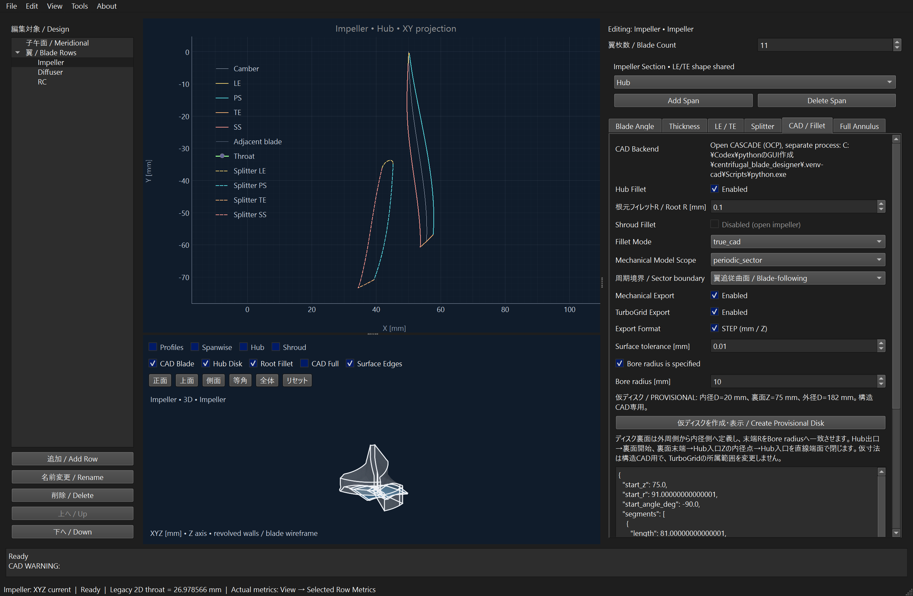

# 翼追従セクターのWindows GUI受入れ

2026-10-26の実行記録。計算コード基準`af2ddba`。
**修正後の通し検証はPASS。** 実CAD workerと公開結果のoverallは`WARNING`で、
仮ディスク`PROVISIONAL`と再構成の全面材料一致`NOT_CONFIRMED`を維持している。
Mechanical artifact・STEP再読込み・この受入れ条件の成功と、全面保証/ANSYSを区別する。

## 範囲

Windows上の実MainWindowを別processで起動し、Qtウィジェットをプログラム操作する。
`Export Mechanical`ボタンの本来のsignal/slot、仮ディスク準備、CAD数値準備、
実OCP worker、GUIでの完了処理、既存のcase公開、CAD previewを通す。
保存先選択ダイアログの返答だけを自動指定する。形状・worker・検査をmockせず、
以前のBREP/checkpointや検査結果に置換しない。人手のマウス・キーボード/F5とは区別する。

既定モデルのImpeller（主翼11枚＋Splitter11枚）、自動仮ディスク、明示R0.1 mm、
`true_cad`・`periodic_sector`・`blade_following`・Mechanical STEPを使う。
ユーザーJSON・既存成果物は変更せず、検証用ディレクトリへ出力する。

## 受入れ手順

1. 以前の検証済みcaseの私有コピーを作り、全ファイルhashを固定する。
2. GUIで上記設定を入力し、Export Mechanicalを押す。
3. 数値準備完了後、workerがCADフェーズへ切り替わった直後にCancel CADを押し、
   所有process tree停止と旧caseの全hash不変を確認する。重いBoolean計算中の取消を実行したとは扱わない。
4. 同じボタンから再実行し、仮置換なしで全周生成・fillet・翼追従切断・再構成・STEP検査を完了する。
5. GUIが公開したcaseとjobのsnapshot hash、STEP bytes hash、保持翼、1solid、
   境界/半径標本、previewのhashと有効状態を照合する。
6. 保存/再読込みを行い、設計値不変を確認する。画面・heartbeat・処理時間を記録して終了する。

ローカルの実行スクリプト・段階ログ・最終測定値は
`artifacts/quality-status-and-gui/native_e2e.py`、`events.jsonl`、`result.json`。
これらはGit対象外の検証資料。画像を掲載する場合は、この実行に対応することを確認する。

## 初回ハーネスの修正

初回は実CAD生成・STEP再読込み・GUIでの公開まで成功したが、検証ハーネスが
「成功公開時に出力先の無関係なmarkerも消える」と期待し、そこでFAILとなった。
`fileio/case_publish.py::staged_case`は旧caseをstageへコピーし、無関係なファイルを保持する契約である。
既存試験`tests/test_case_publish.py::test_complete_generation_preserves_unmanaged_files_and_keeps_backup`
も同じ契約を検査している。
ハーネスの期待が誤っていたため、marker内容が保持されることへ修正した。
計算コード・公差・数値参照・元ファイルは変更していない。

初回のFAIL記録は上記パスへ保持し、全通し成功の件数へ含めない。
初回の実出力を再表示する診断で残るpreview・保存/再読込みの確認条件を点検したが、
これは新しい通し生成の証拠としない。
修正後の最初からの再実行は`artifacts/quality-status-and-gui/attempt-2/`へ分離する。

## 修正後の完了結果

| 確認 | 結果・範囲 |
| --- | --- |
| Windows GUI入口 | 実ウィジェットのExport Mechanicalボタン→仮ディスク→数値準備→実OCP→公開→previewを通過。保存先ダイアログの返答のみ自動指定 |
| 取消と再実行 | 数値準備完了後のCADフェーズ開始直後に取消。`PROCESS_TREE_STOPPED`、旧case全hash不変。次のボタン操作から新jobで再生成成功 |
| 生成条件 | 同梱モデルの主翼11枚＋Splitter11枚、自動仮ディスク、明示R0.1 mm、CAD公差0.01 mm |
| 保持する翼 | `main@0`、`splitter@0`のみ、元全周BREPのfingerprint不変 |
| STEP | 元モデル・再読込みとも有効な1solid。STEP bytesと公開manifestのSHA-256が一致 |
| 境界比較 | STEP全38面を双方向に標本照合。最大距離約1.20×10⁻⁹ mm |
| rolling半径 | STEP前12面・後12面とも標本検査成功。corner全域G1/半径保証ではない |
| GUI完了処理 | GUIのreportがMechanical PASSを保持し、previewのsnapshot hashがjobと一致、有効表示を確認 |
| 保存/再読込み | 設計パラメータが一致。操作後に正常終了 |
| 出力先の無関係ファイル | 成功公開後も検証用markerの内容を保持。旧caseを消す条件へ変更していない |
| 入力・原本 | 計算/試験/既定値等の413入力不変、先行検証の原STEP不変。GUI準備の32座標配列も先行基準と完全一致 |
| ボタン→結果照合 | 2708.968秒、約45分9秒。準備とGUI公開処理を含み、保存/再読込みは後続工程 |
| 応答の観測 | 100 ms周期QTimerで、実行〜GUI完了処理を含む観測最大gap約0.812秒。人手操作・全負荷での応答保証ではない |

job：`artifacts/cad-runs/b1b7463151bc496b836f75932ef97fa7`。
snapshot：`2086e2d569a2a8c9e528a58cd2f3cd2d762ecbe4bc3fbd195eb4aec03264a18d`。
`attempt-2/result.json`がGUI観測、`attempt-2/verification-summary.json`が独立したファイル/hash再照合の結果。
初回FAIL、初回結果の再表示診断、修正後の通し成功を混ぜて件数へ加算しない。

成功したcaseをWindows GUIへ再表示して撮影。通常形状のHub/Shroud補助面を隠し、
CADのHub Disk・翼・Root Fillet・Surface Edgesを表示、CAD Fullはオフ。
これは同じ実出力の表示資料であり、別の新規生成試験ではない。
TurboGridチェック欄の表示は、本結果がTurboGrid出力にも対応する意味ではない。

## この作業の検査

- 短時間63件：`20261026T033803Z-f4800fd8`。
- 関連GUI/worker 23件：`20261026T034653Z-004db873`。
- 既存case公開契約18件：`20261026T044559Z-7a200984`。
- 上記pytestは失敗/error/skip 0。初回ハーネスのFAILは別の検証記録として保持した。
- 変更は文書/画面資料のみ。計算コード・数値fixtureを含む413入力を再照合した。
  全2,661件は直近の同一計算コードの回帰記録であり、本作業では全回帰を再実行していない。

## 対象外

ANSYS Import/Mesh・周期拘束・強度/性能評価、他形状や他Rでの成立、corner全域G1、
全面材料一致の厳密証明、人手の全操作、全負荷でのUI応答保証はこの試験では確認しない。
`PROVISIONAL`と`NOT_CONFIRMED`、有限標本の意味を変えない。

[現行対応表](CURRENT_STATUS.md)、[翼追従方式](BLADE_FOLLOWING_SECTOR.md)。
