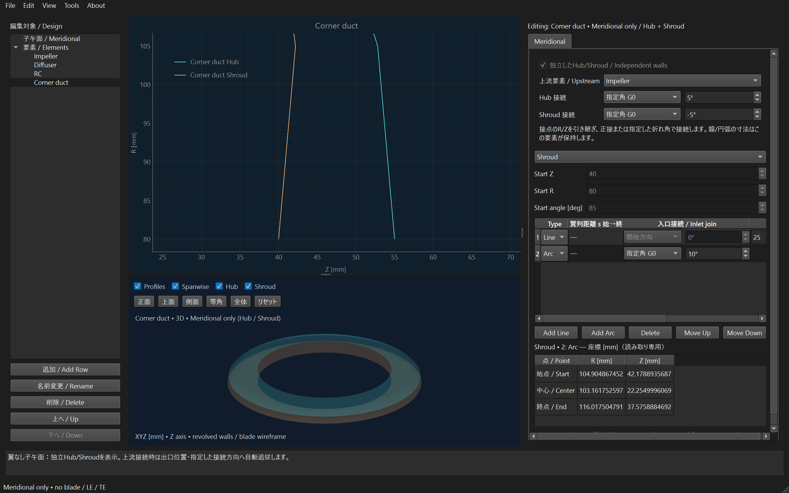

# 子午面の正接接続と指定角接続

線・円弧同士、および独立要素同士で、端点を共有しながら正接しない接続を選べる。
旧データと既定値は正接接続のまま。変更した接点だけに折れ角を保存する。

Windowsプログラム操作で確認した指定角の設定画面。数値は操作例で、設計推奨値ではない。

## 形状を決める入力

折れ角は直前の区間の終端接線から、次の区間の始端接線へ測る。
Zを横軸、Rを縦軸としたとき、正の角度は+Zから+Rへ回転する向き。
範囲は **−180°より大きく、+180°より小さい値**。

| 次の区間 | 入力する値 | 計算で決まる値 |
| --- | --- | --- |
| 直線 | 接続モード、折れ角、長さ | 終点R/Z |
| 円弧 | 接続モード、折れ角、半径、旋回角、CW/CCW | 中心R/Z、終点R/Z |

正接G1では折れ角0°を継承し、指定角G0では入力値を使う。端点位置はどちらも一致する。
指定角0°も保存でき、幾何学的には正接と同じになる。
円弧半径はその区間の円弧半径で、接点を丸めるフィレット半径ではない。

## 線・円弧同士

Meridionalの表の「入口接続 / Inlet join」で「正接 G1」または「指定角 G0」を選び、折れ角を入力する。
表を横スクロールすると長さ・半径・旋回角・CW/CCWの欄がある。
数値は入力中の各桁で再計算せず、フォーカスが外れたとき、またはEnterで確定する。
先頭区間は直前の区間がないため、Start angleを基準とする。「開始角から指定」はその基準からのオフセット。
直線/円弧の型変更、順番変更では、その区間の入口角を一緒に保持する。
円弧の中心・始点・終点のR/Zは既存の座標表で確認できる。

## 要素同士

上部の「上流要素 / Upstream」を選び、その下のHub接続、Shroud接続を個別に設定する。
上流要素の所属区間の出口に下流要素の所属区間の入口を合わせ、指定した折れ角で両壁を配置する。
上流を変更すると、端点一致と指定した折れ角を維持して後続要素が自動追従する。
未接続にすると現在位置を維持する。接続角の値は保持するが、未接続の間は適用しない。

接続中の入口位置・全体の開始角は自動計算。その入口区間の表内コントロールも無効にし、
方向は上部のHub/Shroud接続欄で指定する。二つの角度指定を重ねて入力しない。
既存翼列を接続する場合は「独立したHub/Shroud」を有効にする。

## 保存・表示・出力と制限

- 保存、再読込み、Undo/Redoに対応。正接へ戻す操作も履歴対象。
- 内部定義は区間の`inlet_turn_deg`、要素の`hub_inlet_turn_deg`と`shroud_inlet_turn_deg`。
  `None`が継承、数値が指定角。新しい既定フィールドは旧JSON/snapshotへ追加しない。
- 2Dの子午面と3Dの回転面は同じ区間形状を使う。自己交差、Hub/Shroud接触、負半径は従来の検査で拒否する。
- CSV/TXT壁座標は接点を含む既存の壁データを使う。
- TurboGrid Profile Pointsの壁には、通常の指定点数に加えて非正接の折れ点を含める。
  従来の正接形状の点数・座標は維持する。派生/写像壁に非正接点を持つ組合せは、折れ点の位置対応が未対応のため出力前に拒否する。
- 折れ点では接線と法線が不連続になる。内部の接線照会は接点の下流側を使う。
  面積・スロートの滑らかな流路という仮定や、CADの翼面補間・フィレットの成立は別途確認が必要。
  非正接形状のCAD全体品質やANSYS Import/Meshを保証する機能ではない。

## 検証方法

`tests/test_meridional_corners.py`が線の終点、円弧の中心/終点/接線、異なるHub/Shroud角、上流追従、無効角、保存保護、TurboGrid折れ点を解析式で確認する。
`tests/test_meridional_corners_gui.py`が入力確定、型/順番変更、入口の重複指定防止、Undo/Redo、保存、カメラ保持を確認する。
旧snapshot用の4参照ファイルは変更前`912f9c7`のモデル定義から取得した固定参照で、現在コードから再生成しない。
この4ファイルだけは`.gitattributes`の`-text`でGitの改行変換を止め、別PCでもバイト比較の参照を維持する。
既存の互換性テストでは追加した既定`None`フィールドだけを除いて旧schemaを復元する。数値参照や形状期待値は変更しない。

## 実装箇所と検証結果

- `models/meridional.py`、`models/parameters.py`、`models/blade_rows.py`：区間/要素の任意角、検証と伝達。
- `geometry/meridional_segments.py`、`element_walls.py`：解析的な区間形状、端点/方向拘束、折れ点位置。
- `gui/meridional_join_control.py`、`meridional_editor.py`、`element_walls_editor.py`、`main_window.py`：入力、確定、重複指定防止、履歴。
- `fileio/project_io.py`、`snapshot_compat.py`、`turbogrid_export.py`：旧schema互換、保存、壁の折れ点出力。
- 新規テスト2ファイル、schema復元helper、固定参照JSON4ファイル。既存のsnapshot/仮ディスク比較は、新規の既定Noneだけを除いて比較する。

2026-10-26：追加24件、quick63件、変更18 Pythonの限定Ruffに成功。
Windowsプログラム操作で、同梱モデルに追加した翼なし要素のHub +5°/Shroud −5°、線→円弧 +10°を設定し、
端点一致と実際の折れ角、2D/3D、保存再読込み、壁TXTを確認した。元の共有子午面は不変。
人手/F5・非正接形状の実CAD全体品質・ANSYS Import/Meshは未検証。

初回の全2,731件では5件失敗した。所属翼列/距離列の表示位置2件は既存の位置を維持するよう修正。
仮ディスクの1件は数値差ではなく新しい既定`inlet_turn_deg: None`のschema差で、比較時の旧schema復元へ対応した。
残る2件は既存のWindows終了確認が`NOT_CONFIRMED`となったもの。workerや終了確認条件は変更せず、原因未確定の不安定項目として初回ログを残す。

修正後、通常全2,633件を再実行して成功。関連44件も成功した。
実CAD98件は初回に全件成功しており、その後のソース差分はGUI列配置とテスト内の比較だけで、CAD計算・入力は不変と照合した。
最終的に既存2,707 IDを維持した2,731一意件を全件照合し、failure/error/skip/漏れ/重複/想定外IDは0。
最終の423 Python/JSON入力は再実行開始から不変。

| 最終結果に使用した群 | 件数 | 実行ID |
| --- | --- | --- |
| 通常再実行 | 1,264 | `20261026T140504Z-afe843ed` |
| 通常再実行 | 1,369 | `20261026T140504Z-5ed2e5f0` |
| 実CAD | 98 | `20261026T120633Z-35447f8d` |

ローカル証拠：`artifacts/quality-meridional-corners/full-regression.json`、`source-hashes-final.json`、`post-regression-changes.json`、`native-result.json`。
初回失敗は`20261026T120634Z-62ed8d44`と`20261026T120634Z-ffae45b2`のログに保持する。
