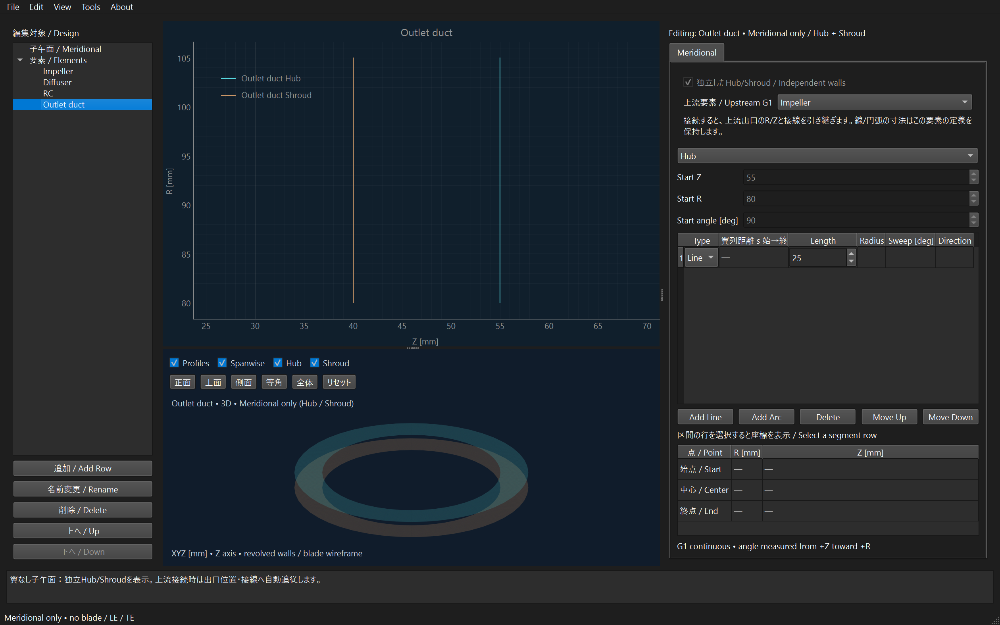
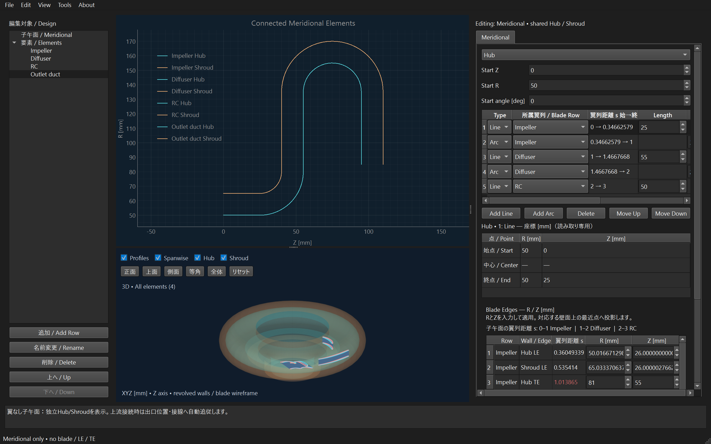

# 翼なし子午面要素と上流へのG1接続

Windowsプログラム操作で同梱モデルへ追加した画面。数値は操作確認例で、設計推奨値ではない。

## 操作

1. 左の「追加 / Add Row」で名前を入力し、「翼なし子午面 / Meridional only」を選ぶ。
2. 選択中の要素を上流として、独立したHub/Shroudを持つ要素を追加する。
   初期値は各壁の上流出口から接線方向へ25 mmの直線。既存の共有子午面は変更しない。
3. 右のMeridionalでHub/Shroudを選び、既存と同じ線・円弧の追加、型変更、寸法編集を行う。
4. 「上流要素 / Upstream G1」で接続先を変更できる。未接続にすると、その時点の位置・向きを保持する。
5. 既存の翼列を下流へつなぐには、その翼列のMeridionalで「独立したHub/Shroud」を有効にし、上流を選ぶ。
   この設定欄と翼列のMeridionalタブは、独立要素を含むプロジェクトで表示する。

接続中の始点R/Z・角度は自動計算で、入力できない。線長・円弧半径・旋回角は各要素が保持する。
上流変更時には後続要素を順に再配置し、両壁でG0（端点一致）とG1（接線方向一致）を維持する。
接続はリスト順でなくIDで保存するため、名前・順番変更では切れない。
循環・存在しない上流は拒否する。接続された後続要素がある間は上流を削除できない。
接続先によって壁の交差や負の半径などが生じる場合は、無効形状として扱う。G2や要素間の全面非干渉は保証しない。

## 表示・保存・出力

- 翼なし要素はMeridionalだけを編集し、2Dの壁と3Dの回転面を表示する。翼・LE/TEは生成しない。
- 左の共通「子午面」は全要素の壁を表示する。共有壁編集は従来の共有壁だけに作用し、独立壁の寸法は変更しない。
- 独立した翼列を選びMeridionalタブを開くと、その壁とLE/TEを表示する。端点はR/Z表で編集する。
  新しい複合子午面グラフでの端点ドラッグは未対応。
- Fileの座標CSV/TXT出力では、翼の出力をオフにしてHub/Shroudを選ぶ。
  XYZ・円筒座標、列順、壁の一括/別ファイルは既存の選択を利用する。
- 翼なし要素のTurboGridプロフィール、Mechanical STEP、TurboGrid CADは未対応として出力前に拒否する。
- 翼なし要素の面積表示は壁からのGross面積のみ。翼間スロートや翼厚差引面積を捏造しない。
- 追加・寸法・接続・接続解除・削除・名前・順番はJSON保存とUndo/Redoの対象。

## データと互換性

`BladeRow.kind = meridional`と`independent_meridional = true`で区別する。
独立壁の定義は各要素の`parameters.hub/shroud`、接続は`upstream_row`に保存する。
内部では互換性のため既存のパラメータ容器を共用するが、翼なし要素の角度・厚さ・LE/TEの残存フィールドは使用しない。
新しい設定を使わない旧JSONには追加の既定フィールドを出さず、既存snapshot/hashを維持する。
新機能を使ったJSONを古いアプリへ読み戻すことは保証しない。

接続位置は上流の所属区間の終点、下流の所属区間の始点。所有者の指定がない壁は全曲線を使う。
接続には各壁の連続した一つの所属区間が必要。独立化した既存翼列は全曲線のコピーと従来のLE/TE fractionを保持し、
所属範囲だけを表示・出力する。所属外の私有曲線も検証対象で、勝手に切り詰めたり再パラメータ化しない。
R/Z面内の剛体移動・回転で各壁を配置する。Hub/Shroudの姿勢は別々に解決する。
β・厚さの入力分布は変更しないが、子午面を変えるため生成される翼のXYZ形状は変わる。
独立壁・接続を含むプロジェクトの座標最適化は現段階で拒否する。共有壁用の最適化変数へ誤変換しない。

## 実装・検証

| 変更対象 | 目的 |
| --- | --- |
| `models/parameters.py`、`models/blade_rows.py`、`models/meridional.py` | 独立壁・接続ID、DAG検査、姿勢の導出、数値壁断片 |
| `geometry/element_walls.py`、`geometry_3d.py`、`row_domain.py`、`preview_computation.py` | G0/G1接続、私有壁による翼生成、所属範囲、翼なしpreview |
| `gui/design_navigator.py`、`element_walls_editor.py`、`element_meridional_view.py`、`main_window.py` | 追加、接続先、共有/私有壁の編集分離、選択と履歴 |
| `gui/blade_edge_editor.py`、`context_meridional.py`、`preview_3d.py` | 偽のLE/TEを作らず、各要素の壁・回転面を表示 |
| `fileio/project_io.py`、`snapshot_compat.py`、`preview_job.py` | 保存・旧snapshot互換・数値process転送 |
| `fileio/turbogrid_export.py`、`export_readiness.py`、`optimization/coordinate_parameters.py` | 対応外の翼出力・最適化を事前拒否 |
| `tests/test_meridional_elements.py`、`test_meridional_elements_gui.py` | 解析的確認とQt操作回帰 |

Qt非依存の`geometry/element_walls.py`が端点・接線の照合、壁の生成と交差検査を行う。
`models/blade_rows.py::row_parameters`が上流を再帰的に解決し、保存された生の寸法を変更しない。
`preview_computation`と数値subprocessは翼なしの結果を扱い、GUI・OCPを計算側へ取り込まない。
`tests/test_meridional_elements.py`は解析的G0/G1、所有区間、複数段追従、無効リンク、旧hash、保存保護、出力ガード、数値processを検査する。
`tests/test_meridional_elements_gui.py`は追加・編集対象切替・共有/独立壁分離・接続解除・Undo/Redo・保存再読込み・壁TXTを検査する。
Qt offscreenの自動試験を人手/F5確認と区別する。独立化・接続した翼列での実CADとANSYS Import/Meshは未検証。
翼なし要素のCAD出力は未対応。

2026-10-26の確認：新規16件、quick63件、変更22 Pythonの限定Ruffに成功。
同梱モデルを使うWindowsプログラム操作で、追加ダイアログ・数値入力・2D/3D・共有壁との分離・上流追従・Undo/Redo・保存再読込み・壁TXTを確認した。
表示画像は描画完了とDeferredDeleteの処理後に取得し、Hub/Shroud両曲線の座標も照合した。人手/F5確認ではない。
変更前の静翼生成コードとの144 XYZ配列比較は完全一致した。

全回帰は2,707一意件（旧2,691を維持し16追加）を通常2群と実CAD1群へ分けて実行した。
初回は2,706成功・1失敗・error/skip 0。実行漏れ・重複・想定外IDは0、固定410 Python/JSON入力は不変。

| 群 | 初回結果 | 実行ID |
| --- | --- | --- |
| 通常 | 1,242成功 | `20261026T105229Z-a0759d15` |
| 通常 | 1,366成功・1失敗 | `20261026T105229Z-1188d665` |
| 実CAD | 98成功 | `20261026T105228Z-8b25f006` |

初回の失敗は既存`test_coordinate_study_gui.py::test_owned_process_cancel_and_close_paths[forced_dialog_delete]`で、
Windowsの終了確認が`PROCESS_TREE_STOPPED`でなく`NOT_CONFIRMED`となったもの。
関連モジュール11件を同じソースで再実行し成功した（`20261026T112147Z-287595a3`）。
原因は未確定で、終了確認の不安定さは残す。既存worker・期待値・終了確認条件は変更していない。
初回失敗を削除せず、再実行の合格と区別する。
回帰後、新規GUI2ファイルの末尾空行だけを除去した。ASTの一致を確認し、関連16件を再実行して成功した。
計算・GUI動作の変更はなく、全回帰の再実行はしていない。差分根拠は`whitespace-normalization.json`に残した。
ローカル証拠：`artifacts/quality-meridional-elements/full-regression.json`、`source-hashes.json`、`native-result.json`。
