# Centrifugal Compressor Blade Designer 利用者マニュアル

更新日：2026-10-26。Windows版の設計画面と座標最適化画面を対象とします。
機能・出力の対応条件は[最新対応表](CURRENT_STATUS.md)、翼追従の実操作検証は
[GUI受入れ記録](GUI_FOLLOWING_SECTOR_ACCEPTANCE.md)を参照してください。
Impeller、Diffuser、Return Channel（RC）の子午面・翼断面を設計し、形状を確認・保存・出力するための手順です。
画面の機能名は英語／日本語の実際の表記に合わせています。

画面例はWindows版アプリから取得した実画面です。全体図に加え、設定欄やダイアログを拡大して掲載しています。
画像をクリックすると元の解像度で確認できます。数値は操作場所を示す現在モデルの例で、推奨設計値ではありません。
クリアランスや派生カットの未使用状態、最適化の未評価状態も、そのまま示しています。

## 目次

- [1. 最初の操作](#quickstart)
- [2. 起動・環境](#startup)
- [3. 画面の見方](#screen)
- [4. 新規・読込・保存・Undo](#projects)
- [5. 翼列の追加・名前・順番・枚数](#rows)
- [6. 座標と用語](#coordinates)
- [7. 子午面の作成と所属翼列](#meridional)
- [8. LE／TE位置](#edge-position)
- [9. 翼角度・厚さ](#distributions)
- [10. LE／TE形状・Rake・配置](#edge-shape)
- [11. スプリッター](#splitter)
- [12. オープンインペラと解析用Shroud](#clearance)
- [13. 容量調整の派生カット](#trim)
- [14. 2D／3D表示](#display)
- [15. 流路面積・スロート・指標](#passage)
- [16. 座標CSV／TXT出力](#coordinate-export)
- [17. TurboGrid出力](#turbogrid)
- [18. CAD／Fillet／STEP](#cad)
- [19. 座標最適化・2目的Pareto比較](#optimization)
- [20. メニュー・ショートカット](#menus)
- [21. 困ったとき](#troubleshooting)
- [22. 保存物・対応範囲・詳しい資料](#references)

<a id="quickstart"></a>
## 1. 最初の操作

既に動作する環境がある場合は、次の順番で操作すると基本の流れを確認できます。

1. アプリを起動します。初期モデルにはImpeller、Diffuser、RCが含まれます。
2. `File → Save Project`で、作業用の新しい名前のJSONへ保存します。
3. 左の`子午面 / Meridional`を選び、Hub／Shroud、所属翼列、LE／TEを確認します。
4. 左の`Impeller`などを選択します。中央上が2D形状、中央下が3D形状、右が編集欄です。
5. 右の`Blade Angle`または`Thickness`で、点を少し動かすか表の数値を編集します。
   数値欄からフォーカスを外し、再計算と形状の更新を待ちます。
6. `Edit → Undo`で元に戻し、`Redo`で再適用できることを確認します。
7. 3Dの`全体`または`リセット`を押し、必要ならHub／Shroudの表示を切り替えます。
8. `File → Save Project`で保存します。
9. 形状座標が必要なら`File → Export → Selected Row Coordinate CSV / TXT`を使います。
   最初はXYZ、識別情報付き、翼・Hub・Shroudを選び、新しい保存先へ出力します。

まずは通常設計とJSON保存を確認し、その後にSplitter、クリアランス、CAD、最適化へ進めます。
設計値を変更する前に別名保存すると、比較用の基準を残せます。

<a id="startup"></a>
## 2. 起動・環境

### 2.1 既存環境で起動する

アプリのフォルダを作業ディレクトリにして実行します。

```powershell
.\.venv\Scripts\python.exe main.py
```

保存済みのプロジェクトを指定する場合：

```powershell
.\.venv\Scripts\python.exe main.py --project "C:\design\my_blade.json"
```

VS Codeでは`blade-designer.code-workspace`を開き、Python Interpreterを
このアプリの`.venv/Scripts/python.exe`へ設定して、`F5 → Blade Designer: Design`で起動します。
通常起動にテスト用の`QT_QPA_PLATFORM=offscreen`を設定しないでください。

### 2.2 初めて別のWindows PCへ導入する

空いている新しい場所へcloneする例です。既存の仮想環境を上書きする手順ではありません。

```powershell
git clone https://github.com/ai-infra-data-lab/centrifugal-blade-designer.git
cd centrifugal-blade-designer
py -3.12 -m venv .venv
.\.venv\Scripts\python.exe -m pip install -r requirements-windows-py312.lock.txt
.\.venv\Scripts\python.exe -m pip check
.\.venv\Scripts\python.exe main.py
```

通常の基準環境はPython 3.12です。固定依存ファイルは開発環境の記録であり、
各PCへの新規導入成功を保証するものではありません。導入後は起動・保存・出力を確認してください。
Python 3.11の過去の動作確認範囲と導入手順は[開発・環境手順](DEVELOPMENT.md)を参照します。
現在の全機能を3.11で再検証したという意味ではありません。

通常設計、座標CSV、TurboGrid Profile PointsにCAD環境は不要です。
CADを使う場合だけ、[CAD環境の導入](CAD_EXPORT.md#環境)に従って`.venv-cad`を別に用意します。
このアプリにはANSYS本体・ライセンス・解析テンプレートは含まれません。

<a id="screen"></a>
## 3. 画面の見方

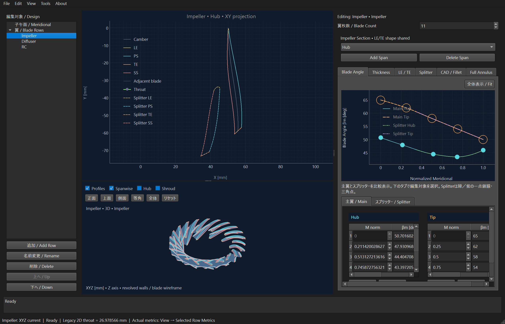

図：同梱初期モデルのImpellerを選択した実画面。右は翼角度、中央下は3D全周表示です。
翼を見やすくするため、3DのHub／Shroud表示を外した例です。

| 場所 | 役割 |
|---|---|
| 左：編集対象 / Design | 子午面、または編集する翼列を選択。下部で追加・名前変更・削除・順序変更 |
| 中央上：2D | 選択した子午面または翼形状。角度・厚さの分布グラフとは別 |
| 中央下：3D | 子午面選択では全翼列。翼列選択ではその翼と所属壁面 |
| 右：編集欄 | 選択対象に応じたタブと入力欄。スクロール・横スクロールできる箇所あり |
| 下部：メッセージ／状態 | 計算状態、警告、エラー、最終有効形状などの説明 |

子午面を選ぶと右は`Meridional`です。翼列を選ぶと`Blade Angle`、`Thickness`、
`LE / TE`、`Full Annulus`などへ切り替わります。Impellerには`Splitter`、`CAD / Fillet`もあります。
表示されない機能は、まず左の編集対象を確認してください。

中央の翼形状を見ながら右の分布グラフを編集します。
境界のスプリッターをドラッグすると、各画面に割り当てる幅や上下の高さを調整できます。

<a id="projects"></a>
## 4. 新規・読込・保存・Undo

| 操作 | メニュー／キー | 内容 |
|---|---|---|
| 新規 | `File → New` / `Ctrl+N` | 同梱の初期モデルから開始 |
| 読込 | `File → Open Project` / `Ctrl+O` | 保存したProject JSONを開く |
| 保存 | `File → Save Project` / `Ctrl+S` | 保存先を指定してProject JSONへ記録 |
| 元に戻す | `Edit → Undo` / `Ctrl+Z` | 確定した設計編集を戻す |
| やり直す | `Edit → Redo` / `Ctrl+Y`、`Ctrl+Shift+Z` | Undoした編集を再適用 |
| 終了 | `File → Exit` | アプリを終了 |

操作前に入力欄からフォーカスを外し、編集を確定してください。
自動保存を前提にせず、New・Open・終了の前に必要なJSONを保存します。
カメラやグラフのズーム操作と、設計値のUndoは別に扱います。

起動・Newは`blade_designer/defaults/default_project.json`を使います。
手元の`blade_v03.json`を編集しただけで起動時の既定値へ自動反映されるわけではありません。

新しい任意設定を含むJSONは、対応する版のアプリで開いてください。
JSONの入力値が同じでも、古い版から円／楕円端部の生成方式などが変更されている場合があります。
過去版との比較は座標出力や形状も確認します。

<a id="rows"></a>
## 5. 翼列の追加・名前・順番・枚数

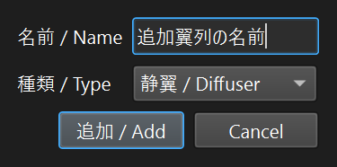

図：左下の`追加 / Add Row`で開く画面。名前と種類を指定してから追加します。
RCも種類は`静翼 / Diffuser`を選び、子午面の所属区間とLE／TEを別途設定します。この撮影では追加を確定せず取り消しています。

1. 左下の`追加 / Add Row`を押します。
2. ダイアログで名前と`インペラ / Impeller`または`静翼 / Diffuser`を指定して追加します。
3. 追加した翼列を選び、子午面の所属区間と専用LE／TE位置を設定します。
4. 右上の`翼枚数 / Blade Count`を指定します。

`名前変更 / Rename`は登録後も使えます。静翼に`RC`と名付けてReturn Channelとして設計できますが、
名前だけで流れ方向が決まるわけではありません。子午面とLE／TEで外径側入口・内径側出口を作ります。

`上へ / Up`、`下へ / Down`は左の一覧の並び順です。
子午面の所属やLE／TEを自動的に並べ替えて新しい流路へ作り直す操作ではありません。
削除前は別名保存し、必要に応じてUndoで戻してください。

角度・厚さ・枚数・端部・Splitter等は翼列別の設定です。
Hub／Shroudはプロジェクトで共有します。共有壁面を変更したら、他の翼列の形状も確認します。

Impellerの枚数Nは主翼枚数です。Splitterを有効にすると原則N枚を追加し、合計2N枚になります。
全周表示の切替と、翼枚数の変更を混同しないでください。

<a id="coordinates"></a>
## 6. 座標と用語

| 用語 | 意味 |
|---|---|
| Hub | 流路のハブ側壁面／翼根元側 |
| Shroud | ケーシング側の子午面。隙間がある場合は翼Tipと別 |
| Tip | 実際の翼端。オープンインペラではShroudから離れる |
| LE / TE | Leading Edge＝前縁、Trailing Edge＝後縁 |
| PS / SS | 圧力面／負圧面の輪郭区分 |
| R / Z | 子午面の半径／軸方向座標。単位mm、回転軸はZ |
| θ | Z軸周りの周方向角。幾何の正方向は+Z側から見たCCW |
| Span | HubからTipへの位置。Hub=0、Tip=1 |
| βm | 子午面方向を基準とする翼角度。0°は子午面方向 |
| Master | 形状生成や出力の基になる詳細な断面輪郭 |

**3種類の0〜1を区別してください。**

- 角度／厚さの横軸：各主翼のLEからTEへの流れ方向位置。LE=0、TE=1。
- Span：Hub=0、Tip=1という翼高さ方向。
- 子午面の翼列距離s：所属区間を入口順に0–1、1–2、2–3…へ換算した表示。

幾何のθの正方向、Editで指定する回転方向、ANSYS側の回転数符号は別の設定です。
外部解析へ渡すときは、軸と向きを実際の形状で照合してください。

<a id="meridional"></a>
## 7. 子午面の作成と所属翼列

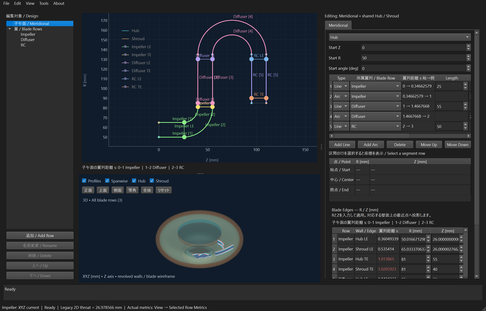

図：子午面選択時の実画面。中央上がR–Z、中央下が全翼列と回転壁面、右がHub編集とLE／TE表です。
下部まで入力欄を見るには右の縦スクロールを使います。

### 7.1 Hub／ShroudのLine・Arc

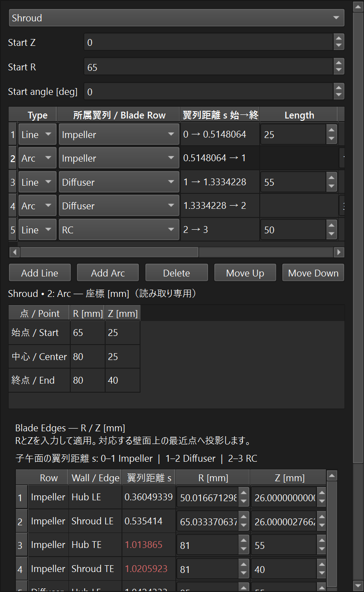

図：`Shroud`の2番目のArc行を選択した設定欄。下の読取り専用表に、始点・中心・終点のR/Zが表示されます。
長さ・半径・Sweepなどが右に隠れている場合は、区間表の横スクロールで確認します。

1. 左の`子午面 / Meridional`を選びます。
2. 右上のHub／Shroudを選択します。
3. `Start Z`、`Start R`、`Start angle [deg]`を設定します。
   開始角は+Zから+Rへ測る接線角です。
4. `Add Line`または`Add Arc`で区間を追加します。
5. Lineは長さ、Arcは半径・旋回角・方向を設定します。前の区間の終端から続く形です。
6. `Type`欄で登録済みのLine／Arcを変更できます。
7. `Delete`、`Move Up`、`Move Down`で区間を整理します。

数値はEnterまたは入力欄からフォーカスを外して確定します。
入力中の1桁ごとに確定した形状だと判断せず、再計算が終わるまで待ってください。

区間の行を選択すると、下の座標欄に始点・終点、Arcでは中心のR/Zが表示されます。
これは読取り専用です。中心座標の直接入力でArcを定義する欄ではありません。

### 7.2 所属翼列と翼列距離s

各区間の`所属翼列 / Blade Row`に、その部分を使うImpeller／Diffuser／RCを指定します。
これは主に翼列の壁面範囲と出力範囲を対応付ける設定です。

Hub、Shroudの両方で、各翼列の区間が連続し、入口からの順番が対応するようにします。
同じ翼列の区間を途中で分断したり、HubとShroudで順番を逆にしたりしないでください。

例えば入口順がImpeller、Diffuser、RCなら、表示sは0–1、1–2、2–3です。
Diffuserのs=1.2は、その壁のDiffuser区間の入口から20%を意味します。
HubとShroudで同じsでも、同じR/Zや同じmmではありません。
この番号は左一覧の順序ではなく、壁面の所属区間の入口順で決まります。

sは読取り専用です。未所属・不連続・順序不一致なら「未設定」、所属外のLE／TEは赤字になります。
自動で位置を修正する表示ではありません。初期モデルでも赤字が出る箇所があるため、出力前に確認します。

<a id="edge-position"></a>
## 8. LE／TE位置

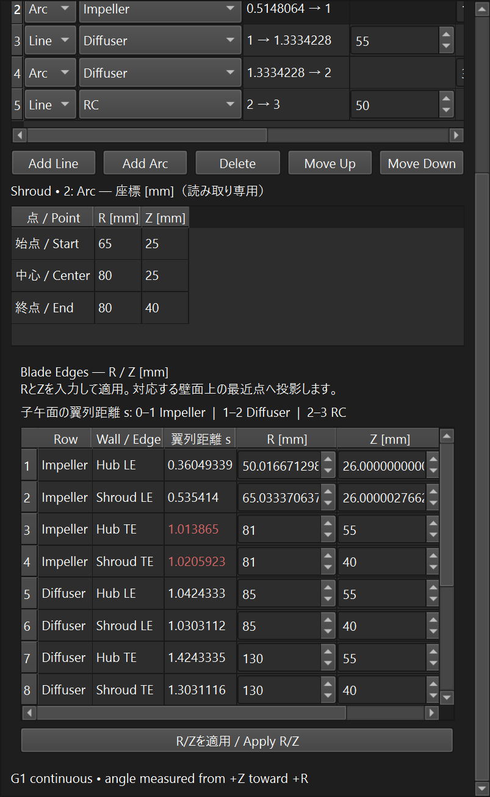

図：子午面設定欄を下へスクロールした状態。`Row`と`Wall / Edge`を確認してR/Zを入力し、下の`Apply R/Z`で適用します。
翼列距離sは読取り専用です。図の赤い値は所属区間から外れた位置を示しており、正常値の推奨例ではありません。
下に隠れたRCの行は表内を縦スクロールして表示します。

1. 子午面を選び、右側を`Blade Edges — R / Z [mm]`までスクロールします。
2. 対象翼列のHub LE、Shroud LE、Hub TE、Shroud TEへR/Zを入力します。
3. `R/Zを適用 / Apply R/Z`を押します。
4. 対応する壁面上の最近点へ投影した位置を、中央の点と表で確認します。

子午面グラフのLE／TEハンドルからも位置を編集できます。
画面のRow名は左の翼列名に対応します。追加翼列には独立したLE／TEを設定します。

Line／Arcを編集するときは壁面編集を優先します。
従来位置を新しい壁面上へ維持できない場合は、新しい壁面に合わせた位置になるため、
壁面編集後にLE／TEを必ず見直してください。

円／楕円の丸め端部では、完成したLEの流れ方向の始端、TEの終端が指定位置に合うように生成します。
PS／SSとの接点そのものを指定するわけではありません。
RCでも外径から内径へ進む「流れ方向」で始端・終端を扱います。
詳細：[端部位置の定義](EDGE_END_POSITION.md)、[翼列距離](MERIDIONAL_ROW_COORDINATES.md)。

<a id="distributions"></a>
## 9. 翼角度・厚さ

### 9.1 編集する

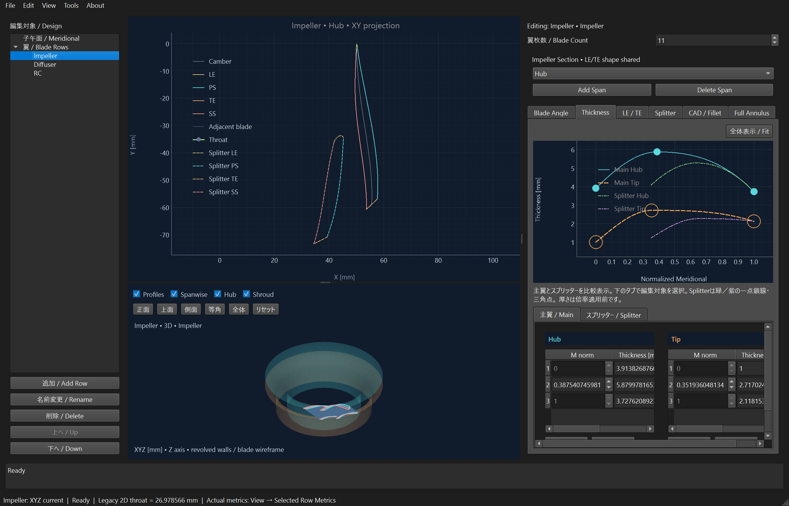

図：右の`Thickness`。上の共通グラフでMain Hub／TipとSplitter Hub／Tipを比較し、下の`主翼 / Main`または`スプリッター / Splitter`で編集対象を切り替えます。
表や操作ボタンが隠れている場合は、右側編集欄のスクロールを使います。

1. 左で翼列を選び、`Blade Angle`または`Thickness`を開きます。
2. Impellerでは必要なSpanを選びます。Hub／Tipのほか、中間Spanを追加・削除できます。
   Diffuser／RCの基本3DはHub／Tipの2断面を結び、同じ分布設定を使います。
3. グラフの点をドラッグするか、表の位置・値を入力します。
4. 必要に応じて`Add Point`、`Delete Point`で制御点を増減します。
5. 全体が見えなければ`全体表示 / Fit`を押します。
6. 中央の2D／3D形状と、下部の計算状態を確認します。

点間の分布はPCHIP補間です。制御点の順序や、位置範囲・端点の制約を守ってください。
厚さはmmの設計分布ですが、全箇所で空間最短距離を直接指定する値ではありません。
翼が閉じない、折り返す、隣接翼と重なる等の場合は、厚さや角度・枚数も確認します。

### 9.2 主翼とSplitterを比較する

グラフ下の`主翼 / Main`、`スプリッター / Splitter`で編集対象を選択します。
両方の線を比較しながら、選択した対象の操作点を編集します。
主翼は円、Splitterは三角の操作点で区別します。線種と凡例も参照してください。

Splitterの横軸も主翼LE=0、TE=1のままです。
開始位置0.5のSplitterは0.5〜1の範囲を編集し、専用分布の上流側の点を補間へ使いません。
2点だけなら直線補間になります。
詳細：[共有グラフ](SHARED_GRAPHS.md)、[Splitterの補間](SPLITTER_INTERPOLATION.md)。

### 9.3 Diffuser／RCの角度編集

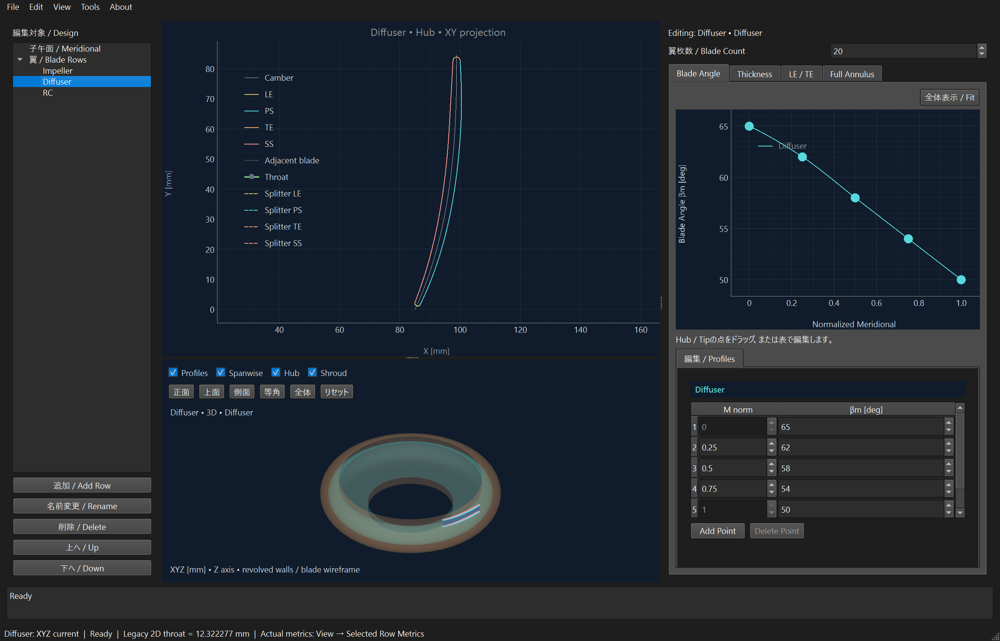

図：左の`Diffuser`を選択した画面。中央の形状と右の角度編集が選択翼列に切り替わります。

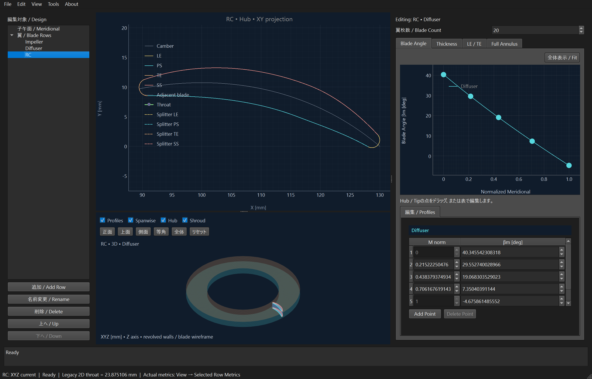

図：左の`RC`を選択した画面。外径側から内径側へ流れるReturn Channelも、静翼として固有の角度・厚さ・LE／TEを持ちます。

<a id="edge-shape"></a>
## 10. LE／TE形状・Rake・配置

### 10.1 端部形状

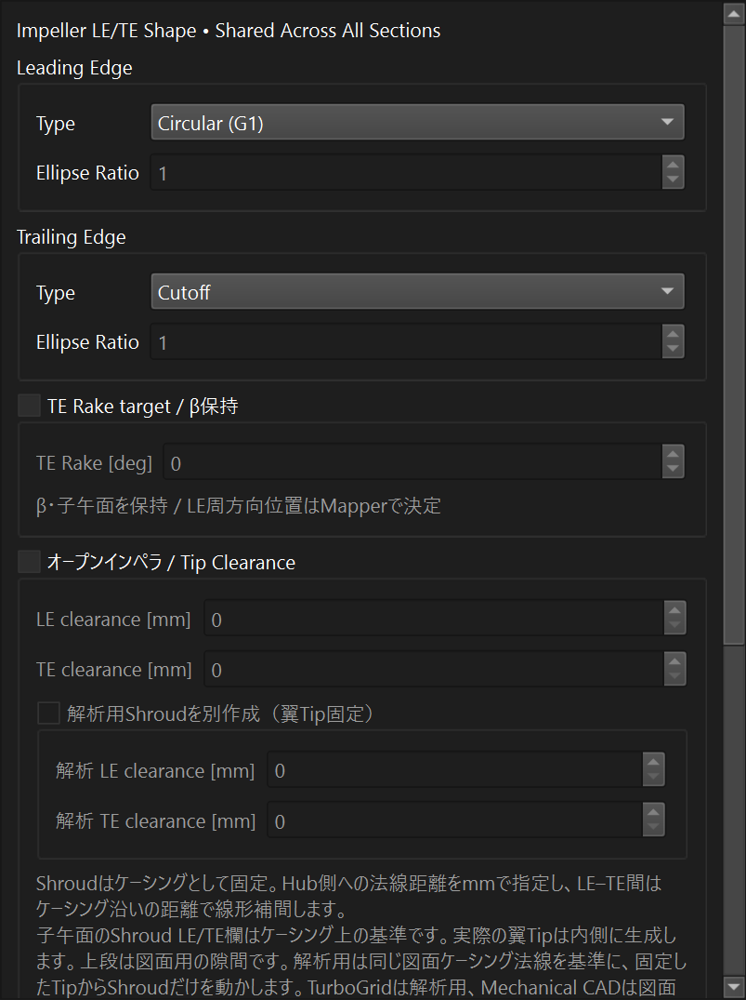

図：Impellerの`LE / TE`上部。`Leading Edge`と`Trailing Edge`のTypeを別々に指定します。
このモデルはLEが`Circular (G1)`、TEが`Cutoff`です。TE Rakeはチェックを入れてから目標角を指定します。

右の`LE / TE`で前縁・後縁のTypeや楕円の軸比などを指定します。

| Type | 扱い |
|---|---|
| Circular | PS／SSへ接線接続する単一円弧 |
| Elliptical | 指定軸比の単一楕円弧で接線接続 |
| Tangent arc (G1) | 単一接線円弧の選択肢 |
| Cutoff | 切断して端部を閉じる方式 |

円／楕円ではPS／SS上の端部近傍の接点を動かし、先端位置と接線条件を両立させます。
成立しない場合に勝手に半円や別形状へ置き換えることはありません。
旧版の半円・半楕円と同じ端部座標になるとは限りません。

ImpellerのTE Cutoffは、子午面のHub側TE半径Rを使い、全Spanを同じ円筒面D=2Rで切ります。
Tip側TEは対応位置の基準であり、別の切断外径ではありません。
届かないSpanやLEを消す切断はエラーになります。

### 10.2 TE Rakeと周方向配置

Impellerの`LE / TE → TE Rake target / β保持`を有効にすると、TE Rake目標角を入力できます。
無効と、有効で0°は異なります。後者は0°へ合わせる目標です。

このRakeはHub／TipのTEキャンバー端点を結ぶ線の周方向の傾きです。
子午面R–Z内の傾きや単純なHub／Tipのθ差ではありません。正は+Z側から見たCCWです。
β・厚さ・子午面を保持し、Parameter Mapperが各Spanの開始θを調整します。
TEを合わせるためLEの周方向配置も変わります。

Rake有効時の`Hub Theta LE`はHub側の配置基準で、TipのLE位置は独立入力ではありません。
LE SweepとTE Rakeを、それぞれ任意の独立目標として同時入力する機能ではありません。
目標が到達不能なら、入力角・形状を変更するかUndoで戻します。

<a id="splitter"></a>
## 11. スプリッター

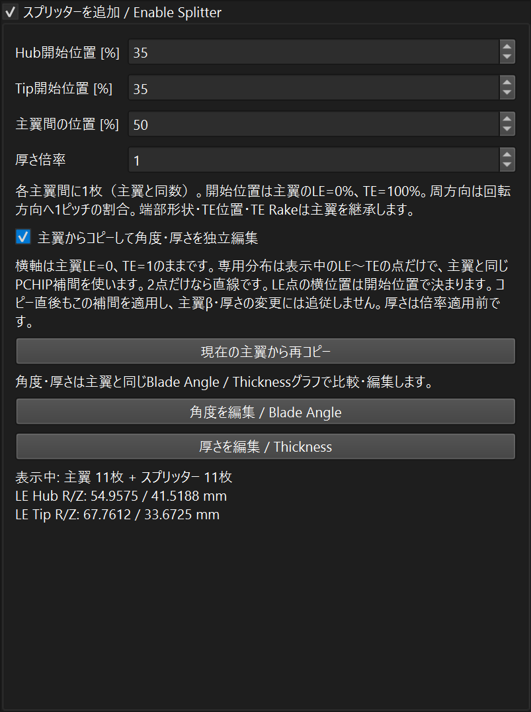

図：`Splitter`タブ。Hub／Tipの開始位置、主翼間の周方向位置、厚さ倍率、主翼からの独立編集を設定します。
角度・厚さのボタンは、主翼と比較できる共通グラフへ移動するためのものです。

1. Impellerを選び、`Splitter`を開きます。
2. `スプリッターを追加 / Enable Splitter`を有効にします。
3. `Hub開始位置 [%]`、`Tip開始位置 [%]`を指定します。主翼LE=0%、TE=100%です。
4. `主翼間の位置 [%]`を指定します。回転方向へ1ピッチの割合で、50%が中間です。
5. `厚さ倍率`を指定します。1は元の厚さと同じ倍率です。

初期の主翼連動では、主翼の対応する流れ方向区間から分布を使います。
短い翼へ主翼全体の分布を引き伸ばす処理ではありません。
TE位置・端部設定・TE Rakeは主翼に追従します。

独立編集したい場合は`主翼からコピーして角度・厚さを独立編集`を有効にし、
`Blade Angle`／`Thickness`のSplitter側で調整します。
`現在の主翼から再コピー`は専用分布を更新する操作です。コピー後は主翼の変更に追従しません。
表示中LE〜TEの点だけで補間するため、コピー直後でも主翼から切り出した形と差が出る場合があります。

翼形状の色は主翼・Splitter共通で、LE＝黄、PS＝水色、TE＝橙、SS＝ピンクです。
2DのSplitterは破線で区別します。分布グラフの色はHub／Tip・主翼／Splitterの区別であり、
翼輪郭の部位の色とは意味が異なります。

<a id="clearance"></a>
## 12. オープンインペラと解析用Shroud

### 12.1 図面形状のクリアランス

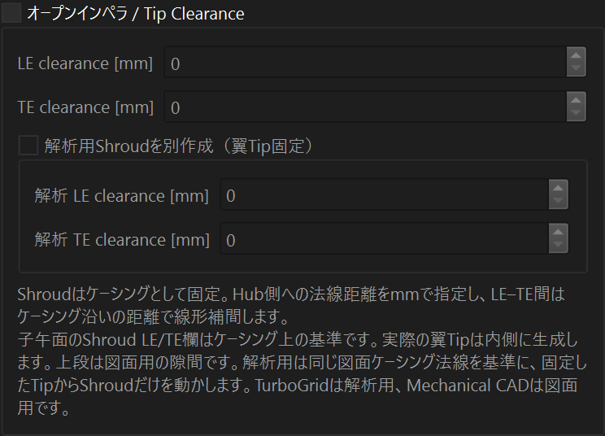

図：`LE / TE`内を下へスクロールして表示する設定欄。上段が図面用、内側のグループが解析用です。
撮影モデルでは未使用のため入力欄が無効です。上段を有効にしてLE／TEの隙間を指定し、解析用も分ける場合は内側を有効にします。

1. Impellerの`LE / TE → オープンインペラ / Tip Clearance`を有効にします。
2. LE／TEの隙間[mm]を指定し、Enterまたはフォーカス移動で確定します。
3. 子午面と3Dで、物理的な翼Tipとケーシングが分かれていることを確認します。

既存Shroudをケーシングとして固定し、Hub側へ法線方向に離した翼Tipを作ります。
LE〜TEの隙間はケーシング沿いの距離で線形補間します。
単純なR方向差やZ方向差を指定する欄ではありません。

### 12.2 翼Tipを維持した解析用ケーシング

`解析用Shroudを別作成（翼Tip固定）`を有効にして、解析用LE／TE値を指定します。
図面用の翼Tipを維持し、解析用Shroudだけを別に作成します。
3Dでは必要に応じて`Tip`／`Analysis`の表示チェックも使います。

汎用座標出力で図面用／解析用／両方を選べます。
TurboGrid Profile Pointsは有効な解析用Shroudへ接続する経路があります。
Mechanical CADは図面形状側を維持します。
詳細：[翼端クリアランス](TIP_CLEARANCE.md)、[解析用Shroud](ANALYSIS_SHROUD.md)。

<a id="trim"></a>
## 13. 容量調整の派生カット

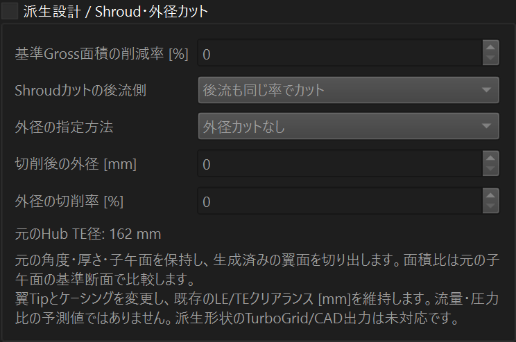

図：`LE / TE`内の派生カット設定。Shroudの面積カット、外径の径／割合指定、後流側の扱いを選びます。
撮影モデルではカットは未使用です。表示の0を設計の推奨値として扱わないでください。

1. Impellerの`LE / TE → 派生設計 / Shroud・外径カット`を有効にします。
2. `基準Gross面積の削減率 [%]`でShroudカットを指定します。
3. 外径は「なし」「指定外径[mm]」「元外径からの切削率[%]」から選択します。
4. Shroudカットの後流側を選びます。
   - `後流も同じ率でカット`
   - `TEから後流端まで滑らかに元へ戻す`
5. 元形状と派生形状、LE／TE、クリアランス、後流との接続を確認します。

元の角度・厚さ・子午面の設計値を保持し、生成済みの翼面から主翼とSplitterを切り出します。
中央は派生形状、右の角度・厚さグラフは元設計の分布です。
面積の削減率は半径の削減率ではなく、流量や圧力比を直接指定する値でもありません。

後流を戻す方式では、TEより下流で滑らかに元へ接続するため、復元区間は一定面積比ではありません。
共有の元壁面や他翼列をカットする操作ではありません。

**派生カットのTurboGrid／CAD出力は現状未対応で、書込み前に拒否します。**
対応する汎用座標出力を使い、元設計を代わりに出したものと混同しないでください。
性能への効果や加工・接続の成立は外部で評価します。詳細：[派生カット仕様](IMPELLER_TRIM_SPEC.md)。

<a id="display"></a>
## 14. 2D／3D表示

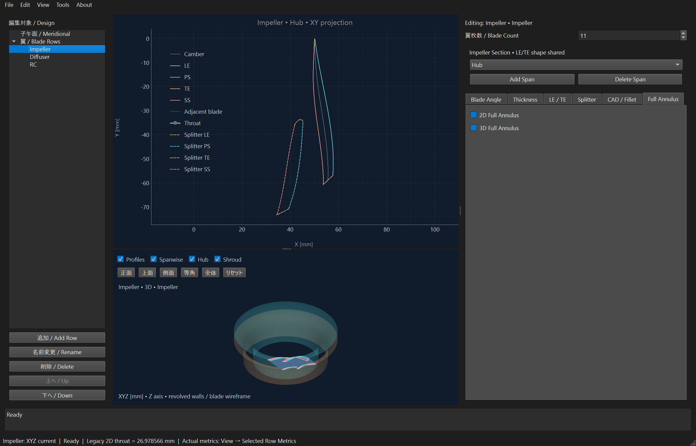

図：`Full Annulus`の2つのチェックは2Dと3Dで独立しています。中央下の`正面`・`上面`・`側面`・`等角`・`全体`・`リセット`で視点を操作します。

| 操作 | 方法 |
|---|---|
| 3D自由回転 | 描画領域で左ドラッグ。トラックボール方式 |
| 3D平行移動 | 描画領域で右ドラッグ |
| 3D拡大縮小 | マウスホイール |
| 向きを決める | `正面`、`上面`、`側面`、`等角` |
| 全体を収める | `全体`。方向を保って合わせる |
| 初期視点へ戻る | `リセット` |
| 2D／3Dを全周化 | `Full Annulus`タブ、またはViewの各Full Annulus |
| グラフ全体表示 | `全体表示 / Fit`、または`View → Fit View` |

`正面`は+Xから、`上面`は+Zから、`側面`は+Yから見ます。
`Profiles`は断面、`Spanwise`はSpan間の接続線、`Hub`／`Shroud`は回転壁面の表示です。
壁面で翼が見えにくければチェックを外して確認します。

Impellerの2Dは選択断面・投影面を確認し、必要なら`View → Projection`で`XY`／`XZ`／`YZ`を選びます。
静翼の基本2Dは3D生成したHub断面のXY投影です。RCも子午面上の実形状を基に表示します。
全周表示は確認用の複製であり、汎用座標を全周複製して書き出す指定ではありません。

通常の編集ではカメラやズームが保持される場合があります。対象や寸法が大きく変わったらFitします。
タブや解析画面を開いた際は全体表示へ合わせる機能もあります。
再計算中や失敗時は、表示中の形状が最新か最終有効形状かを状態欄で確認してください。

<a id="passage"></a>
## 15. 流路面積・スロート・指標

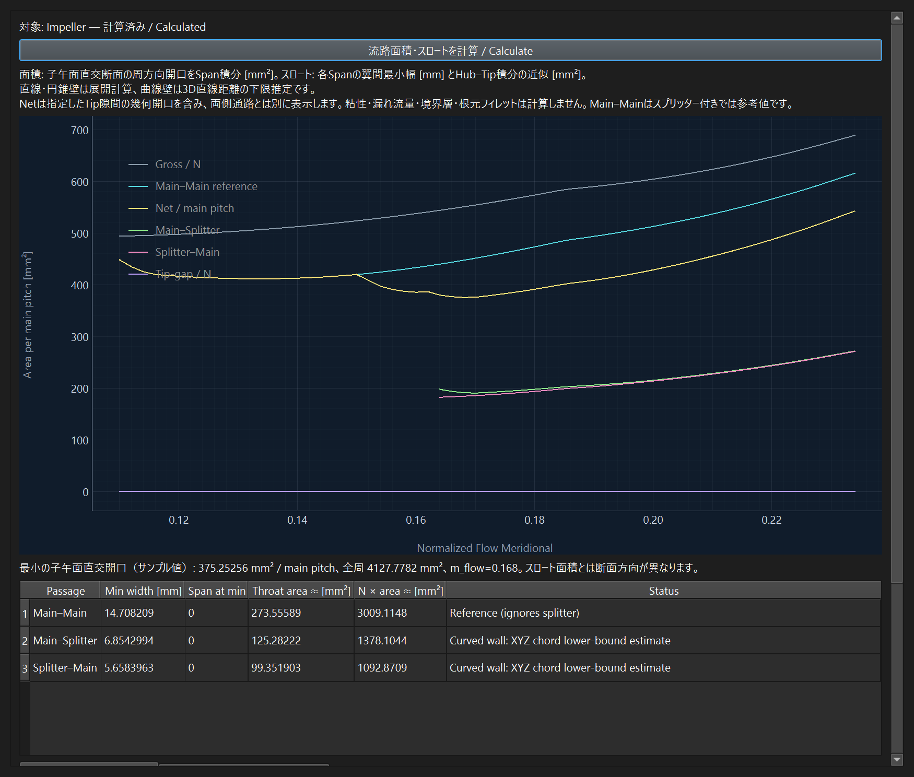

図：`View`から開く`Passage Area / Throat`。主翼間と、Splitterを含む隣接流路の結果を区別して確認します。

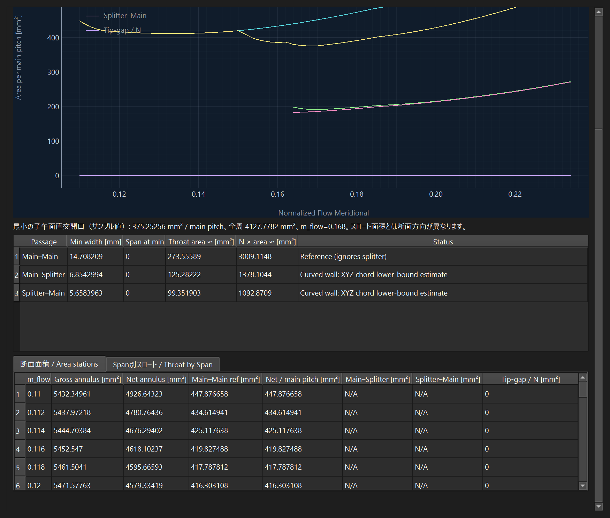

図：`Calculate`で同梱モデルを計算し、下へスクロールした結果表。Main–MainはSplitterを無視した参考値で、両側の通路とは区別します。
これはアプリの幾何計算結果であり、実験やCFDで検証した性能値ではありません。

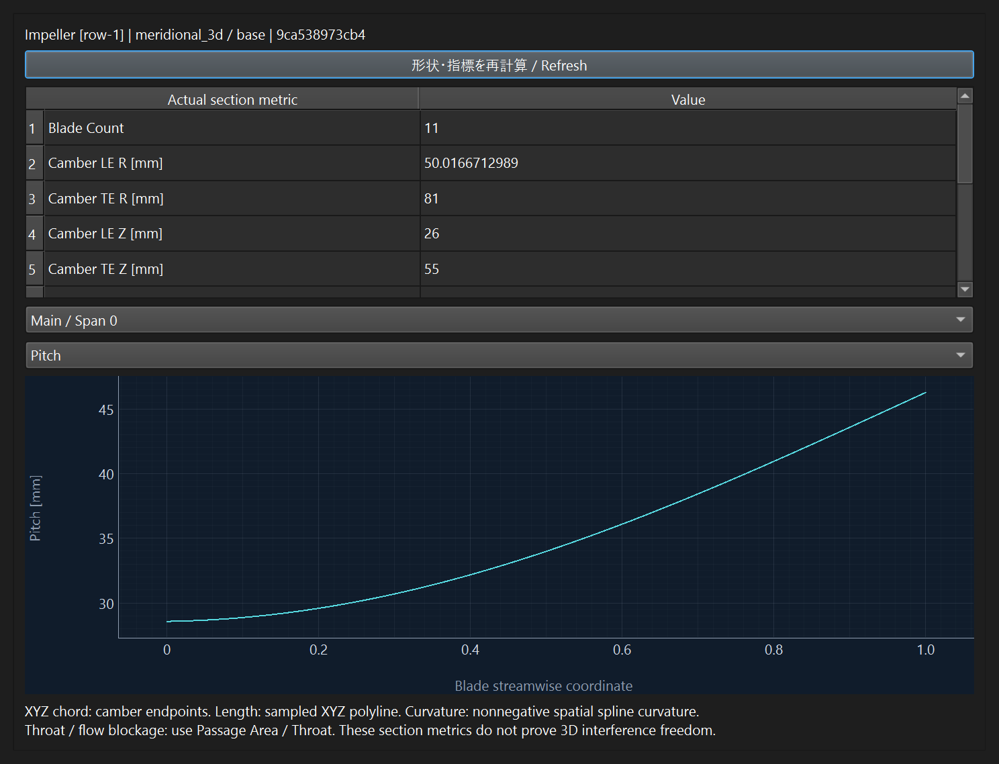

図：`Selected Row Metrics`。画面の翼列名・形状の状態を確認してから数値を読みます。これらは幾何指標であり、CFDの性能結果ではありません。

1. 左で解析する翼列を選びます。
2. `View → Passage Area / Throat`を開きます。
3. `流路面積・スロートを計算 / Calculate`を押します。
4. 面積グラフ、一覧、断面別／Span別の値とStatusを確認します。
5. 形状や対象を変えたら再度計算します。旧結果を最新の値と扱わないでください。

| 表示 | 意味 |
|---|---|
| Gross | 翼厚を引く前の子午面直交の幾何面積 |
| Main–Main reference | 主翼間の参考値。Splitterがある場合もSplitterを無視 |
| Net / main pitch | 主翼と存在するSplitterの閉塞を差し引いた1主翼ピッチの開口 |
| Main–Splitter / Splitter–Main | 各側の通路。必要な全SpanにSplitterがあるときに評価 |
| Net annulus | 主翼枚数N×1ピッチNet。主翼間参考値を別に加算しない |
| Tip-gap / N | 翼Tipからケーシングまでの1ピッチ分の幾何開口 |

スロートは隣接翼の断面輪郭間の最小幅と、そのHub–Tip間の積分面積の近似です。
直線母線の円筒・円錐では展開距離、曲線母線では3D直線距離による下限推定を使います。
Span間の未サンプル部分や曲面上の厳密なスロート面、粘性・剥離・チョーク流量は評価しません。
N/Aや未判定を0と解釈しないでください。

`View → Flow Area`は既存の総面積表示です。
現在の選択形状の指標は`Selected Row Metrics`を使います。
`Metrics`／`Diffuser Curvature`はlegacy radial 2Dの経路を含むため、RCの実3Dと混同しません。
詳細：[流路面積・スロート](PASSAGE_ANALYSIS.md)。

<a id="coordinate-export"></a>
## 16. 座標CSV／TXT出力

### 16.1 推奨する汎用出力

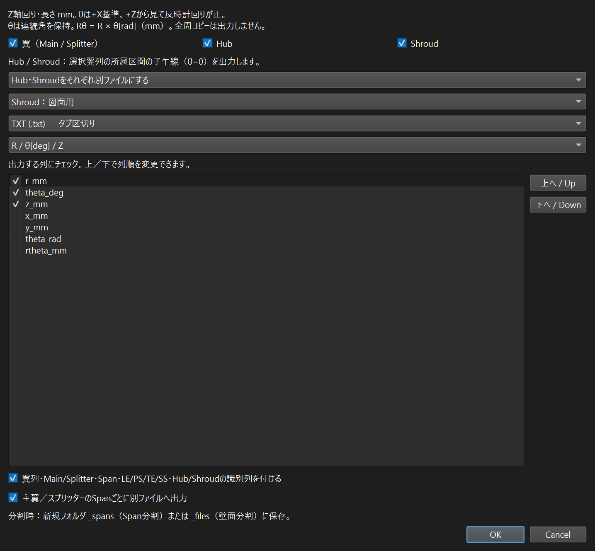

図：`Selected Row Coordinate CSV / TXT`で開く設定例。ここでは翼・Hub・Shroud、壁面別、TXT、R／θ[deg]／Z、Span別を選択しています。
この段階ではまだファイルは作成されません。設定を確認してOKを押し、次に新しい保存先を指定します。

1. 左で翼列を選びます。
2. `File → Export → Selected Row Coordinate CSV / TXT`を開きます。
3. 翼、Hub、Shroudの必要なものを選びます。
4. XYZ、R/θ/Z、Rθ/Z/Rなどの列を選び、必要なら順序を変えます。
5. 識別情報、Span分割、壁面のまとめ方、拡張子を指定します。
6. 保存先を指定し、出力後にヘッダー・単位・対象翼列を確認します。

| 設定 | 選べる内容 |
|---|---|
| 座標列 | X/Y/Z[mm]、R[mm]、θ[deg]、θ[rad]、Rθ[mm]から選択・並べ替え |
| 識別情報 | row、Main/Splitter、Span、LE/PS/TE/SSなど。外部処理には付加を推奨 |
| 翼の分割 | 一括、またはMain／SplitterのSpanごと |
| 壁面 | 翼と1ファイル、Hub＋Shroudを別にまとめる、Hub／Shroud別ファイル |
| Shroud | 図面用、解析用、両方。解析用は作成済みの場合 |
| 拡張子 | CSVはカンマ区切り、TXTはタブ区切り |

RθはR×θ[rad]です。θを度で出す場合もRθの計算に度を掛けません。
壁面は所属区間の子午線で、θ=0です。回転面を全面点群にした出力ではありません。
どの座標情報が必要かを外部処理側と合わせ、必要情報を欠く列選択にしないでください。

Span分割・壁面の別ファイル出力では、新規フォルダへ一式を作ります。既存フォルダは使用できません。
通常の1ファイル出力でも、比較用データを残すには新しい名前を推奨します。

### 16.2 他のCSVとの違い

| メニュー | 用途 |
|---|---|
| Selected Row Coordinate CSV / TXT | 現在の実master形状を任意の座標表現で出力 |
| Selected Row XYZ CSV | 現在の実master形状の固定列XYZ出力 |
| Diffuser Segments CSV / Diffuser Contour CSV | legacy radial 2D互換の出力 |

legacy CSVを現在の子午面ベースのDiffuser／RC形状として使用しないでください。
汎用CSVとTurboGrid専用ファイルも別形式です。詳細：[座標CSV／TXT](COORDINATE_CSV.md)。

<a id="turbogrid"></a>
## 17. TurboGrid出力

### 17.1 Profile Points経路

1. 左で出力する翼列を選び、必要なら`View → Output Settings`で単位・軸・ファイル名を確認します。
2. `File → Export → Export Readiness`で可否と理由を確認します。
3. `File → Export → TurboGrid Export`から専用の新しいケースフォルダへ出力します。
4. `BladeGen.inf`とHub／Shroud／profileファイルをANSYS環境へ一式で渡します。
5. TurboGrid側で軸・単位・回転向き・枚数・LE/TE・壁面・隙間を確認し、ImportとMeshを検証します。

主翼＋Splitterではprofile内に両翼を保持します。Blade Setsは主翼枚数、Blades Per Setは2です。
全周の翼を全部コピーしたファイルではありません。

正のクリアランスでは物理TipとShroud延長断面を両方出す場合があります。
出力後の案内と`BladeGen.inf`コメントを読み、TurboGridで物理TipのProfile Numberを設定します。
Splitterがあれば両翼で確認してください。コメントはTurboGridの設定を自動変更する命令ではありません。

Diffuser／RCでは所属壁面と流れ方向を確認します。
派生カットなど対応外の構成では出力を拒否し、元形状で代用しません。
Profile Pointsに根元フィレットは含まれません。

### 17.2 CAD経路との区別

`CAD / Fillet → Export TurboGrid`はCAD経路です。通常の`File → Export → TurboGrid Export`と区別します。
CADのSTEP中間ファイル、対応形式への変換、ANSYS Import、Meshはそれぞれ別の完了状態です。
Profile Pointsの出力成功だけでCAD連携も成功したとは扱いません。

本環境でANSYSのImport／Meshは未検証です。
実機の作業は[ANSYS環境向け引継ぎ](ANSYS_EXTERNAL_ANALYSIS_HANDOFF.md)、
[Splitter出力](TURBOGRID_SPLITTER.md)、[隙間付き出力](TURBOGRID_CLEARANCE.md)を参照します。

<a id="cad"></a>
## 18. CAD／Fillet／STEP

### 18.1 基本手順

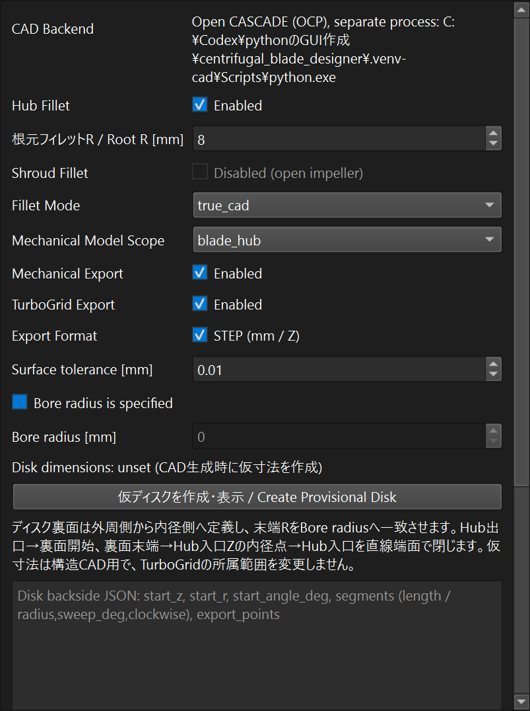

図：`CAD / Fillet`の上部。根元R、Fillet Mode、Mechanical Model Scope、出力対象を指定します。
表示されているR8は現在モデルの設定値であり、生成成功を示す値ではありません。生成・検査・出力のボタンはさらに下へスクロールして表示します。

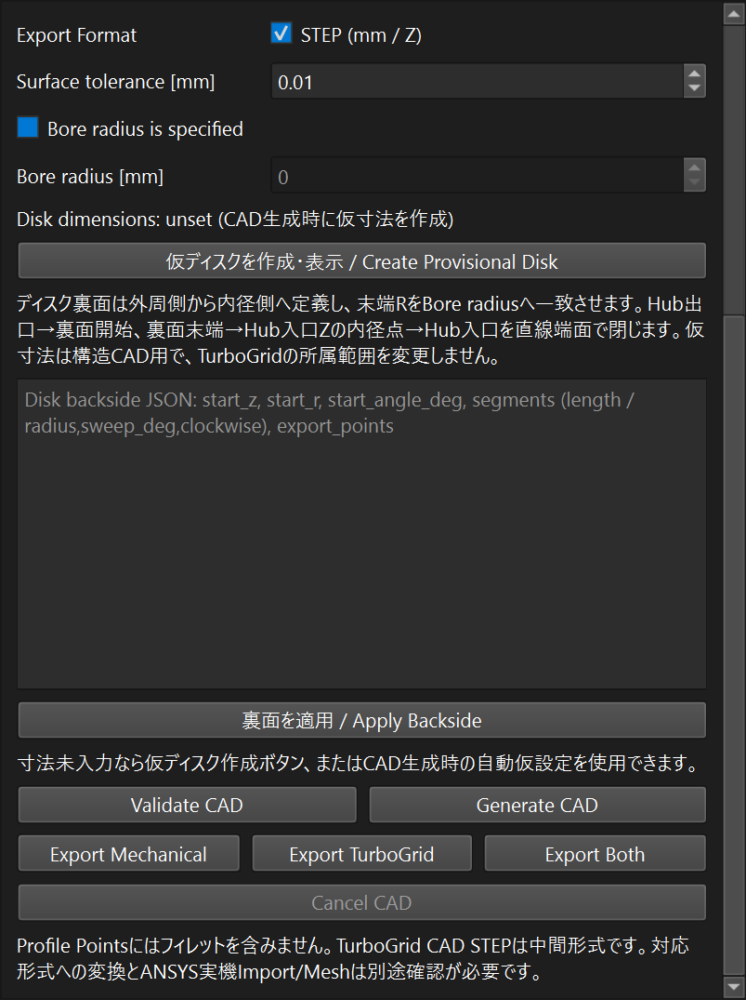

図：同じ`CAD / Fillet`欄を下へスクロールした状態。`Validate CAD`、`Generate CAD`、Mechanical／TurboGridの出力、`Cancel CAD`を確認できます。
この撮影ではボタンは実行していません。CAD成功の判断には、生成後のレポートを確認してください。

1. 別のCAD環境`.venv-cad`を準備します。通常アプリ用環境へOCPを混在させません。
2. Impellerを選び、`CAD / Fillet`タブを開きます。
3. 最初は`Blade Only`で翼単体を確認し、必要なScopeへ進めます。
4. Hub付き形状では実寸法を入力するか、試作用に`仮ディスクを作成・表示`を使います。
5. `根元フィレットR / Root R [mm]`を設定して確定します。
6. `Generate CAD`または`Validate CAD`で生成・検証結果を確認します。
7. `Export Mechanical`、`Export TurboGrid`、`Export Both`を用途に応じて選択します。

| Scope | 確認対象 |
|---|---|
| Blade Only | 翼単体。根元フィレットは作成しない |
| 単翼＋Hub | 主翼と有効なSplitter、全周ディスクとの結合 |
| 周期セクタ | 全周実体を1ピッチで切断した形状 |
| 全周インペラ | 全配置を含む実体 |

1セクターで翼を切りたくない場合は、Scopeを`periodic_sector`にし、
`周期境界 / Sector boundary`を`翼追従曲面 / Blade-following`へ変更します。
主翼3枚以上・`Hub Fillet`有効／`true_cad`・Mechanical専用です。翼・Splitter・根元フィレットを避ける周期面を検査し、
成立しないときはエラーにします。`Export Mechanical`を使い、TurboGridや`Export Both`とは分けます。
従来の`固定平面 / Fixed planes`は残ります。[方式・制限・検証](BLADE_FOLLOWING_SECTOR.md)。

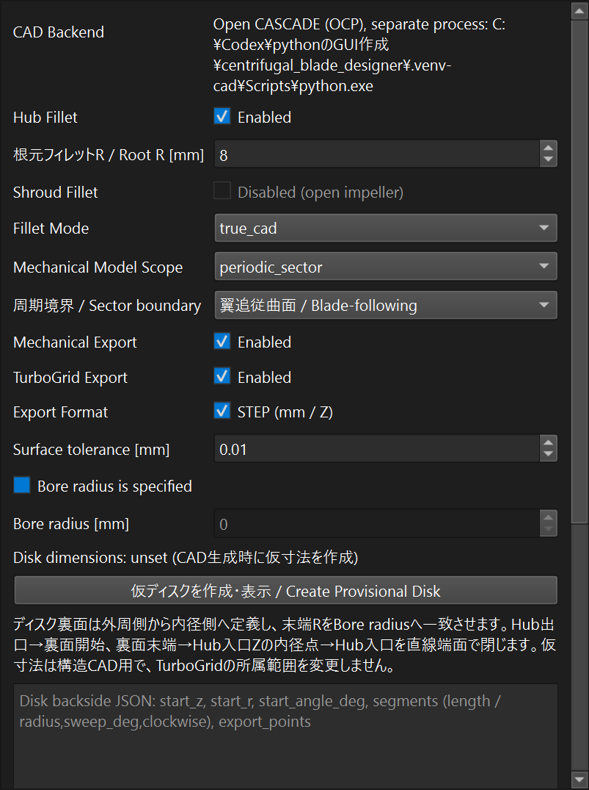

図：新しい境界選択欄。表示中のR8は操作例であり、この半径での生成成功を示しません。

仮ディスクは`PROVISIONAL`です。実機のディスク寸法や構造強度の保証ではありません。
ディスク単体の表示成功を、翼との結合・フィレット成功と混同しないでください。

Root Rの初期値8 mmは固定値ではなく、形状によって成立範囲が異なります。
現在の既定モデルでは仮ディスク・明示R0.1 mmで全周フィレットとSTEP往復の成功記録があります。
任意の形状・半径で成立する保証ではなく、不成立のRをアプリが勝手に縮小することもありません。

### 18.2 結果の読み方

- CAD形状生成、フィレット、STEP保存・再読込み、ANSYS Import、Meshを別々に確認します。
- WARNINGの理由を読みます。仮寸法の警告と、形状不成立のエラーは異なります。
- `CONVERSION_REQUIRED`は、TurboGrid CADの対応形式への変換が必要な状態です。
- `NOT_TESTED`や未判定を合格と解釈しません。
- 正の隙間・解析用Shroud・派生カットなど、組合せによりCAD経路を拒否する場合があります。

CADは長時間かかることがあります。進捗表示と`Cancel`を使います。
計算開始後に設計を変更した場合、古いCADが現在値として表示されないよう管理されます。
生成時点のsnapshotとレポートを確認してください。

CAD表示はBREPの表示用三角形化であり、表示画面自体はSTEPの代替ではありません。
詳細な寸法入力・成立範囲・保存構成は[CAD操作手順](CAD_EXPORT.md)、
現在の全周処理は[全周フィレット](FULL_FILLET_ASSEMBLY.md)、
周期形状の制約は[既定周期セクタの確認](DEFAULT_PERIODIC_SECTOR_CHECK.md)を参照します。

<a id="optimization"></a>
## 19. 座標最適化・2目的Pareto比較

現在の設計を基準として角度・厚さ・共有子午面の差分を探索し、複数翼列の座標を一緒に出力します。
CFD、mesh、CAD、3D面そのものの最適化をアプリ内で実行する機能ではありません。

### 19.1 最初のStudyを作る

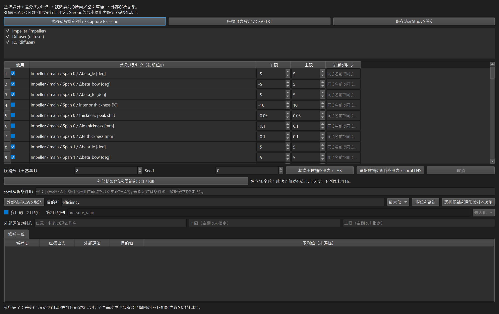

図：`Tools → Coordinate Optimization / 座標最適化`を開き、`Capture Baseline`を押した直後。
上で対象翼列、中央で変数・上下限・連動グループを設定します。画面例は移行のみで、候補出力・外部解析は未実行です。

1. 通常Editorで設計値を確定し、Project JSONを保存します。
2. `Tools → Coordinate Optimization / 座標最適化`を開きます。
3. `現在の設計を移行 / Capture Baseline`で基準を取得します。通常設計へはまだ変更を適用しません。
4. 対象翼列を先に選び、その後で変数の使用・上下限・連動グループを設定します。
   翼列を選び直すと変数と現在結果を作り直すためです。
5. `座標出力設定 / CSV・TXT`を指定します。外部処理にはXYZと識別情報、必要な壁面を含めます。
6. 同じ回転数・作動点・物性・mesh/solver方針・評価量定義を識別する`外部解析条件ID`を設定します。
7. 候補数とSeedを指定し、`基準＋候補を出力 / LHS`で新しいStudyフォルダへ出力します。

差分0は基準設計を保持します。元分布全体を近似曲線に置き換えてから探索する方式ではありません。
同じ意味・単位の変数に同一の連動名を付けると、Hub／Tipや翼列間で同じ補正を使えます。
共有子午面を変更する候補は、非選択翼列へ影響する場合も成立を検査します。

### 19.2 外部評価を取り込む

1. Studyの`manifest.json`、`baseline.json`、全case座標、結果テンプレートを一式で保存します。
2. 外部で実際に解析し、`external_results_template.csv`のコピーへ結果を記入します。
3. `外部結果CSVを取込`で読み込みます。
4. 目的列と最大化／最小化、必要なら評価列の上下限制約を設定し、順位を更新します。

run ID、candidate ID、candidate hash、解析条件IDは元の値を使います。
解析statusは`success`／`failed`／`pending`です。
成功には有限数値を入れ、失敗・未評価は評価欄を空欄にします。0や代理モデル予測を入れません。
2目的なら効率・圧力比などの数値評価列を追加し、単位と定義を統一します。

### 19.3 RBFで次候補を提案する

1. 十分な成功評価を取り込みます。独立変数dに対して最低`max(8, 2d+4)`点が必要です。
   画面にも必要点数を表示します。連動した変数は1つの独立変数として数えます。
2. 目的列、方向、制約を設定して`外部結果から次候補を出力 / RBF`を押します。
3. 1〜50候補を新しいStudyへ出力します。学習と座標生成は別プロセスで実行します。
4. 予測値と外部評価欄を区別します。新候補の実評価欄は未評価のままです。
5. 新候補を外部で評価し、CSVを取り込んで次の提案へ進めます。

各モデルが4分割の検証に合格した場合だけ提案します。不十分なデータや予測不成立では出力を拒否します。
同じ基準・変数・範囲・連動・解析条件の過去実評価を引き継ぎます。
次の反復には少なくとも新しい候補1件の成功評価が必要です。予測だけで学習を進めません。
LHSは実験計画、Local LHSは選択候補の近傍候補生成であり、RBF提案とは別の方法です。

### 19.4 2目的のトレードオフを見る

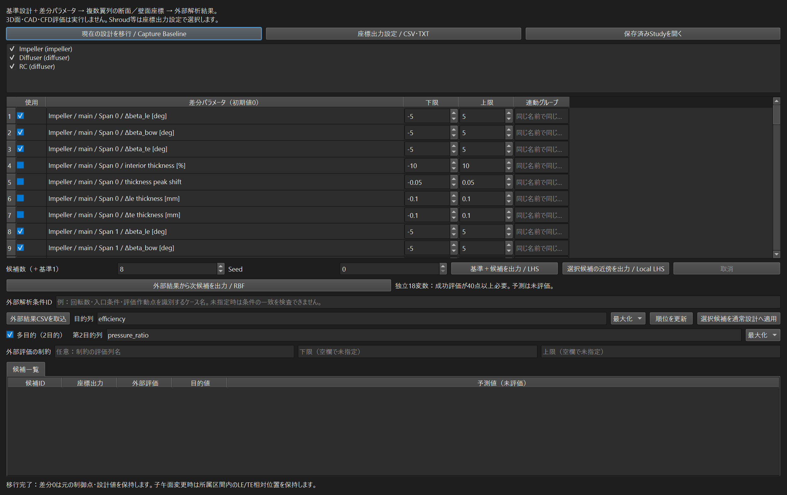

図：`多目的（2目的）`を有効にした初期設定。目的列と第2目的列、それぞれの最大化／最小化を選びます。
まだ外部結果を取り込んでいないため、候補一覧は空です。Pareto図は実評価を取り込んでから確認します。架空の解析点は掲載していません。

1. 第1目的の列・方向を指定します。
2. `多目的（2目的）`を有効にし、第2目的の列・方向を指定します。
3. 順位を更新し、`候補一覧`の実評価Pareto層と`Pareto図`タブを確認します。
4. 必要ならその設定でRBFの次候補を出力します。

第1層は、比較対象内で他候補に支配されない候補です。
例えば効率を上げるほど損失も増えるなら、どちらを優先するかという選択が残ります。
第1層の先頭を唯一の最良設計と解釈しないでください。

灰色は実評価の他層、水色は実評価の第1層、橙色×はモデル予測です。
予測を実評価Pareto層へ混ぜません。図の実評価は現在のStudyのCSVで、全履歴の一括表示ではありません。
3目的以上、予測不確かさ、大域最適解の保証は現状の対象外です。

### 19.5 通常設計へ適用・再開する

`選択候補を通常設計へ適用`で候補を反映します。Undo／Redoで戻せます。
通常設計が基準取得後に変わっていたら、誤適用を避けるため拒否します。
適用後は別名JSONへ保存して形状と指標を確認します。

`保存済みStudyを開く`で再開できます。外部結果CSVは再取込みします。
RBFの2目的Studyは目的名・方向も復元します。初期LHSの目的設定は必要に応じて選び直します。
形状版が異なる旧Studyは、新しい座標で出し直して外部で再評価します。

**無人反復は未実装です。** 現在は候補生成→外部解析→CSV取込→再学習を操作して進めます。
ANSYSのある環境で自動接続を作る場合は[外部解析引継ぎ資料](ANSYS_EXTERNAL_ANALYSIS_HANDOFF.md)を使います。
詳細：[座標最適化の仕様・検証](COORDINATE_OPTIMIZATION.md)。

`Tools → Open Optimization Mode in Separate Window`は既存のlegacy radial 2D系の別モードです。
ここで説明した複数翼列・RBF・2目的Studyの入口とは区別してください。

<a id="menus"></a>
## 20. メニュー・ショートカット

| メニュー | 主な機能 |
|---|---|
| File | New、Open Project、Save Project、Export、Exit |
| Edit | Undo、Redo、Cancel Recalculation、Rotation Direction (+Z)、Reverse Rotation |
| View | 2D/3D Full Annulus、Fit View、Output Settings、各解析画面、Projection、CAD Surface Reference |
| Tools | Coordinate Optimization、legacy Optimizationの別ウィンドウ |
| About | About Blade Designer。アプリ名・表示版・角度定義 |

| キー | 操作 |
|---|---|
| Ctrl+N / Ctrl+O / Ctrl+S | New / Open Project / Save Project |
| Ctrl+Z | Undo |
| Ctrl+Y / Ctrl+Shift+Z | Redo |
| F5 | VS Codeの設定でアプリを起動・デバッグ。アプリ内の再計算ショートカットではない |

`Edit → Cancel Recalculation`は通常の形状再計算を止める入口です。
CADやStudy出力は各画面の`Cancel`を使います。終了処理が終わるまで待ってください。

<a id="troubleshooting"></a>
## 21. 困ったとき

| 症状 | 確認・対処 |
|---|---|
| 編集タブが見えない | 左の子午面／翼列選択を確認。Impeller専用の設定は静翼では表示されない |
| 入力後も形状が変わらない | Enterかフォーカス移動で確定し、再計算状態とエラー欄を確認 |
| モデルが見切れる／小さい | `View → Fit View`、3Dの`全体`／`リセット`。壁面の表示も確認 |
| 翼が壁面で隠れる | 3DのHub／Shroudを外す。単翼／全周を切り替えて確認 |
| 一部の数値欄が隠れる | 右の縦・横スクロール、ウィンドウサイズ、画面分割を調整 |
| LE／TEが赤字、所属が未設定 | 両壁の所属区間、入口順、分断、LE／TEの範囲を確認 |
| 壁面編集後にLE／TEが変わった | 壁面編集優先で新壁面へ対応した可能性。R/Zを確認して再設定 |
| 端部の接線接続が成立しない | 厚さ、分布、端部形式・軸比、LE/TE間隔を見直す。点数増加だけで解決しない |
| 古い形状が表示される | 状態欄の最終有効形状／更新待ちを確認。旧表示を最新値として出力しない |
| RCの別グラフ／CSVと形が違う | legacy radial 2Dと実3Dの経路を確認。Selected Row系を使う |
| Splitterをコピーしたのに曲線が違う | 可視LE〜TEだけのPCHIP補間が適用される。2点なら直線 |
| 面積・スロートがN/A | Statusを確認。交差・閉塞・欠測・曲線壁の近似などを区別 |
| TurboGrid／CADが出力不可 | Export Readiness、所属壁面、派生カット、隙間・解析Shroudの対応範囲を確認 |
| CADのR8で失敗する | Rは形状依存。Scope・ディスク・根元位相を確認し、意図した小径を明示して試す |
| CADが遅い | 進捗を確認し、必要なら専用Cancel。ディスク単体成功を全周生成成功と扱わない |
| Study出力先を指定できない | 新しいフォルダ名を使う。既存Studyは上書きしない |
| 外部CSVを取り込めない | run/case/hash/条件ID、重複列・行、有限数値、failed/pendingの空欄を確認 |
| RBFが提案しない | 成功点数、独立変数、欠測、目的の変動、検証失敗、既試行・制約を確認 |
| 候補の適用が拒否される | 基準取得後の通常設計変更、座標生成失敗、hash不一致を確認 |

エラー時はメッセージ、対象翼列、再現するProject JSON、操作順を残します。
正常だった別名保存ファイルを保持し、未判定を無理に通すために公差やJSONを直接書き換えないでください。

<a id="references"></a>
## 22. 保存物・対応範囲・詳しい資料

### 22.1 何を保存するか

| 保存物 | 役割 |
|---|---|
| Project JSON | 再編集する設計値。元設計・派生設定・翼列別設定を保管 |
| 座標CSV／TXT | 外部へ渡す形状データ。Projectの代替ではない |
| TurboGrid一式 | INFと曲線をまとめて保管。必要な実機設定・確認記録も添える |
| CADケース／レポート | STEPと生成時のsnapshot、検証状態・設定を保管 |
| Studyフォルダ全体 | baseline、manifest、case座標、結果テンプレート。1ファイルだけでは再開できない |
| 外部評価CSV＋解析記録 | 実評価、単位/定義/条件、使用mesh・solver・収束の出所 |

ユーザーの原本や解析成果物は、アプリのソースGitへ自動保存されるわけではありません。
別PCへ移すときは、アプリのcloneに加えて必要なProject／Study／外部結果を別途コピーします。

### 22.2 検証状態の読み方

現在のコードには通常設計・幾何・保存／出力・最適化と実CADの自動試験があります。
既存全回帰2,647件成功という記録は、全入力・全形状・実機性能の保証ではありません。
ANSYS Import／Mesh／Solveや人手での全GUI操作を、自動試験成功と同じ意味には扱いません。

本書の画面例は2026-10-25に同梱モデルからWindowsアプリを別プロセスで起動して取得しました。
表示・視点設定を変えた例で、Project原本と同梱既定値を保存・変更していません。
画面の数値は操作例であり、実機・CFDによる性能検証値ではありません。

### 22.3 詳しい資料

- [機能と検証記録](../FEATURES.md)
- [インストール・開発・手動確認](DEVELOPMENT.md)
- [子午面の区間座標](MERIDIONAL_COORDINATES.md)
- [子午面の翼列距離](MERIDIONAL_ROW_COORDINATES.md)
- [端部位置](EDGE_END_POSITION.md)／[円・楕円の接線接続](ROUNDED_EDGE_TANGENCY.md)
- [共有分布グラフ](SHARED_GRAPHS.md)／[Splitter補間](SPLITTER_INTERPOLATION.md)
- [翼端クリアランス](TIP_CLEARANCE.md)／[解析用Shroud](ANALYSIS_SHROUD.md)
- [派生カット](IMPELLER_TRIM_SPEC.md)／[流路面積・スロート](PASSAGE_ANALYSIS.md)
- [座標CSV／TXT](COORDINATE_CSV.md)
- [TurboGrid Splitter](TURBOGRID_SPLITTER.md)／[TurboGrid隙間](TURBOGRID_CLEARANCE.md)
- [CAD操作](CAD_EXPORT.md)／[全周フィレット](FULL_FILLET_ASSEMBLY.md)
- [座標最適化](COORDINATE_OPTIMIZATION.md)
- [ANSYS側の生成AIへ渡す引継ぎファイル](ANSYS_EXTERNAL_ANALYSIS_HANDOFF.md)
